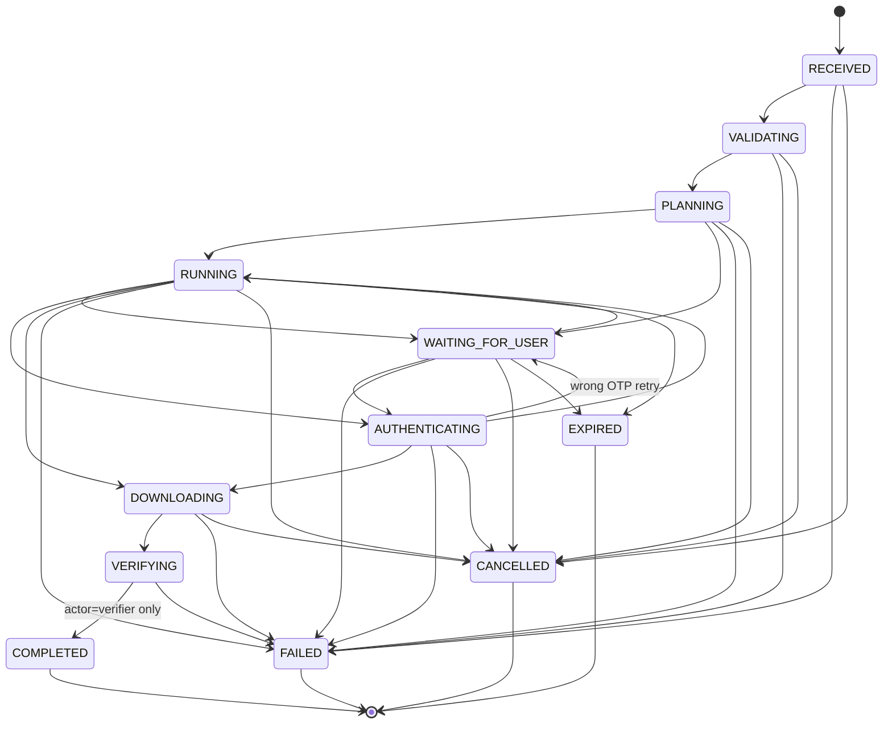

# Saral AI — Multi-Agent Engineering Architecture & Operational Guide (AGENTS.md)

**Version:** 1.0  
**Target Environment:** Flutter Mobile App (Android) + FastAPI Backend (Render Free) + Headless Playwright Worker + Supabase Free  
**Zero-Cost Operating Budget:** ₹0 / month  

---

## 1. Mission Statement

Saral AI is an outcome-oriented civic assistant designed to empower Indian citizens in accessing essential government services (starting with Aadhaar e-KYC document retrieval) without navigating fragmented, opaque official web portals.

Citizens interact via natural language chat in regional languages or English. The backend classifies intent, orchestrates deterministic workflows, coordinates a headless browser automation worker, securely pauses for citizen input (CAPTCHA and OTP), strictly validates the resulting payload, and delivers the encrypted official document privately to the citizen's on-device vault.

---

## 2. Non-Negotiable Architectural Invariants

Every agent working on this codebase must adhere strictly to these non-negotiable invariants. Any violation is an immediate pull request rejection.

### Rule 1: Zero Persistence of Sensitive Verification Credentials
- **OTP and CAPTCHA values are strictly ephemeral in-memory relays.**
- They must **NEVER** be persisted to PostgreSQL, stored in Supabase Realtime payloads, logged to standard error/out, or injected into any LLM prompt.
- Handled exclusively via Pydantic `SecretStr` across FastAPI controllers and in-memory `asyncio.Future` structures in the `ChallengeBroker`.
- Playwright tracing, video recordings, and HAR logging are permanently disabled in production.

### Rule 2: Verifier-Only Completion Gate
- A task can **ONLY** transition from `VERIFYING` to `COMPLETED` if and only if:
  1. The actor is explicitly `actor="verifier"`.
  2. The 5-point document security inspection passes.
- **An LLM saying "the task is finished" or returning a success message can NEVER complete a task.** Any attempt by an LLM or user to transition a task to `COMPLETED` is rejected with an exception.

### Rule 3: Strict PII & Biometric Scrubbing
- All user inputs and chat messages pass through the PII Scrubber before being persisted to the database or sent to any LLM.
- 12-digit Aadhaar / VID numbers validated by the **Verhoeff Dihedral Group $D_5$ algorithm** are masked to visual format `XXXX-XXXX-1234`.
- Phone numbers are masked to `[REDACTED_PHONE]`.
- Email addresses are masked to `[REDACTED_EMAIL]`.
- Biometric terms (fingerprint, iris scan, retina) are sanitized to `[REDACTED_BIOMETRIC]`.
- One-time passwords are redacted to `[REDACTED_OTP]`.
- Backend logs pass through `RedactingLogFilter` to prevent leaks of Authorization headers, Bearer tokens, or credentials.

### Rule 4: Route-Level Domain Allowlisting
- The Playwright browser worker enforces route-level interception (`context.route("**/*")`).
- Any network request targeting a domain not explicitly registered in `ALLOWED_DOMAINS` is instantly aborted.
- Unauthorized external redirects immediately terminate the automation session and transition the task to `FAILED`.

### Rule 5: Multi-Tenant Row Level Security & JWT Verification
- All protected API routes require a valid Supabase JWT bearer token.
- Strict resource ownership is validated on every endpoint (`task.user_id == current_user.id`, `document.user_id == current_user.id`).
- User B cannot view, cancel, submit inputs to, or download documents belonging to User A.

### Rule 6: 5-Point Document Security Verifier
Before any downloaded payload is accepted as a valid citizen document:
1. **Magic Header Check:** Must start with `%PDF-` bytes.
2. **Size Bounds Check:** Must be strictly between 10 KB and 5 MB.
3. **Structure & EOF Check:** Must contain valid cross-reference tables and `%%EOF` trailer.
4. **Malicious Action Check:** Must contain **zero** `/JavaScript` or `/Launch` action dictionaries.
5. **Cryptographic Checksum:** SHA-256 hash is computed, and `pdf_encrypted` flag is verified (e-Aadhaar PDFs are password-protected by UIDAI).

### Rule 7: Mobile UI Security & Monochrome Aesthetic
- **Monochrome Theme Tokens Only:** Palette consists strictly of `#000000` (pitch black), `#0A0A0A` (canvas), `#141414` (surface), `#1A1A1A` (dark grey), and `#FFFFFF` (white). Zero accent hues or brand colors.
- **Typography:** Arapey for headings and wordmark; Inter for UI text and data entry.
- **Screen Protection:** Android `FLAG_SECURE` window manager flag is activated on all sensitive screens (Auth, OTP Sheet, Document Vault) to block screenshots, video capture, and recent task previews.
- **Keyboard Hardening:** Inputs disable suggestions (`enableSuggestions: false`), disable autocorrect (`autocorrect: false`), and suppress clipboard autofill.

---

## 3. Deterministic Task State Machine

Task transitions are governed exclusively by `transition(task, new_status, actor)`. Invalid edges raise `InvalidStateTransitionError`.



### Transition Matrix & Actor Permissions

| Current State | Permitted Next States | Authorized Actors | Timeouts / Constraints |
|---|---|---|---|
| `RECEIVED` | `VALIDATING`, `FAILED`, `CANCELLED` | `system`, `orchestrator`, `user` (cancel) | Task timeout: 10 minutes |
| `VALIDATING` | `PLANNING`, `FAILED`, `CANCELLED` | `orchestrator`, `system` | Schema & policy validation |
| `PLANNING` | `RUNNING`, `WAITING_FOR_USER`, `FAILED`, `CANCELLED` | `orchestrator`, `system` | Workflow plan generation |
| `RUNNING` | `WAITING_FOR_USER`, `AUTHENTICATING`, `DOWNLOADING`, `FAILED`, `CANCELLED`, `EXPIRED` | `orchestrator`, `worker`, `watchdog` | Automation active |
| `WAITING_FOR_USER` | `RUNNING`, `AUTHENTICATING`, `FAILED`, `CANCELLED`, `EXPIRED` | `user`, `orchestrator`, `watchdog` | Challenge timeout: 180 seconds |
| `AUTHENTICATING` | `RUNNING`, `WAITING_FOR_USER`, `DOWNLOADING`, `FAILED`, `CANCELLED` | `worker`, `orchestrator` | Max 3 OTP attempts |
| `DOWNLOADING` | `VERIFYING`, `FAILED`, `CANCELLED` | `worker`, `orchestrator` | Single expected stream |
| `VERIFYING` | `COMPLETED`, `FAILED` | **`verifier` ONLY** | 5-point document security scan |
| `COMPLETED` | *None (Terminal)* | — | Row and signed URL generated |
| `FAILED` | *None (Terminal)* | — | Error code and reason recorded |
| `CANCELLED` | *None (Terminal)* | — | Worker context aborted |
| `EXPIRED` | *None (Terminal)* | — | Timed out without citizen input |

---

## 4. Multi-Agent Team Roles & Responsibilities

| Role | Domain | Primary Responsibilities |
|---|---|---|
| **Sentinel / Lead Orchestrator** | Architecture & Coordination | Enforces project contracts, reviews cross-module PRs, oversees gates. |
| **Backend Engineer** | `backend/app/` | Implements FastAPI endpoints, JWT verification, PII scrubber, Groq streaming, queue pooling (`FOR UPDATE SKIP LOCKED`), challenge broker. |
| **Worker Engineer** | `backend/app/worker/`, `mock_portal/` | Implements Playwright runner, in-memory CAPTCHA scraping, OTP entry, download interception, 5-point document verifier, and mock portal. |
| **Mobile Engineer** | `app/` | Implements Flutter client, Riverpod state, GoRouter, monochrome theme, Arapey/Inter typography, `FLAG_SECURE`, SSE chat consumer, document vault. |
| **DevOps Engineer** | `.github/`, `render.yaml`, config | Manages CI/CD pipelines, daily keepalive ping, hourly retention sweep cron, Render blueprints, environment templates. |
| **E2E Test Writer / Auditor** | `tests/`, `run_e2e_tests.py` | Develops and maintains opaque-box 4-tier test suite, boundary analysis, adversarial attack vectors, and security verification. |

---

## 5. Verification Commands

### End-to-End Test Suite Runner (All 4 Tiers)
```bash
# Standalone E2E runner (Recommended)
uv run --with pytest python run_e2e_tests.py

# Specific tier execution
python run_e2e_tests.py --tier 1   # Category-Partition Feature Coverage
python run_e2e_tests.py --tier 2   # Boundaries, Corners & Timeouts
python run_e2e_tests.py --tier 3   # Pairwise Subsystem Integrations
python run_e2e_tests.py --tier 4   # Real-World Scenarios
```

### Supabase Database & Security Verification
```bash
# Verify schema tables, constraints, RLS policies, and triggers
python supabase/tests/verify_schema.py

# Run database tests via pytest
pytest supabase/tests/ -v
```

### Backend Test Suite
```bash
# Run backend unit and integration tests
cd backend && pytest tests/ -v
```

### Flutter Mobile App Static Analysis & Tests
```bash
cd app
# Static analysis (must report 0 errors and 0 warnings)
flutter analyze

# Widget & Unit test suite
flutter test
```

---

## 6. Emergency Kill-Switches & Failure Recovery

1. **Worker WebSocket Disconnect:** If the browser worker drops connection, active tasks pause in `RUNNING`. The watchdog transitions them to `FAILED` after 60 seconds with error code `WORKER_UNAVAILABLE`.
2. **Citizen Lockout Protection:** After 3 invalid OTP submissions, the session terminates with status `FAILED` and error code `OTP_ATTEMPTS_EXCEEDED` to protect citizen UIDAI credentials from suspension.
3. **Storage Retention Sweep:** The hourly GitHub Actions cron (`cleanup.yml`) calls `POST /internal/cleanup` to permanently purge documents exceeding citizen retention limits from both PostgreSQL and Supabase Storage.
